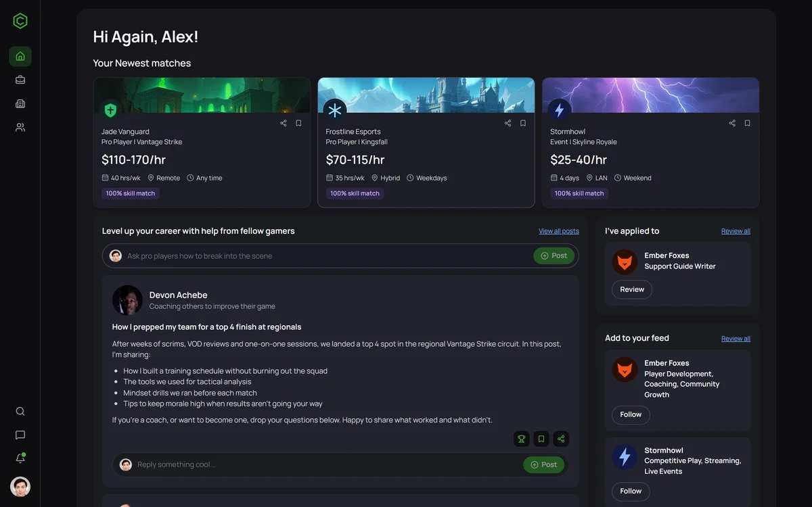
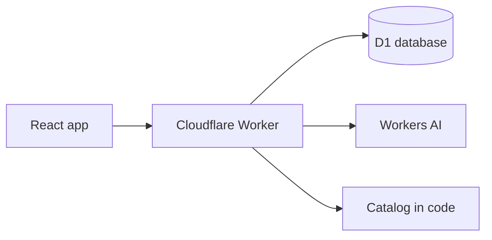

# Cantera

A talent platform for esports. Players build a profile, find teams and roles, apply, and talk to recruiters.

"Cantera" is Spanish for a club's youth academy, the place where new talent comes from.

**[Try the demo](https://cantera.fsucatti-portfolio.workers.dev)**



Design by **Julian Sucatti**. Built by **Francisco Sucatti**.

Every team, game and character in the app is invented. Game pictures are AI-generated. Characters use stock photos, with [credits here](docs/IMAGE-CREDITS.md): the people photographed have no connection to this project.

## Getting started

On the login screen, click **Try it as a guest**. You get a sample player profile, with no email needed. It's deleted after 7 days.

Then try this path:

1. On the home screen, check **Your Newest matches**, ranked by how well your skills fit each role.
2. Open a match and click **Apply for this position**.
3. The recruiter writes to you in the **Inbox**. Answer them: replies are written by AI, in your language.
4. Go to your profile, in the bottom left, and change your skills. Your matches change too.

## What you can do

| Area | Features |
|---|---|
| **Home** | Job matches, your applications, teams to follow, and a community feed |
| **Jobs Board** | Search, filters by type, saved listings, and full role descriptions |
| **Applications** | Apply with a note, withdraw, and get a message from the recruiter |
| **Teams** | Team pages with open roles, and following |
| **People** | Fictional coaches, recruiters and creators you can message |
| **Inbox** | Conversations with unread counts and notifications |
| **Profile** | Avatar, background, skills, work history, awards, highlights and linked accounts |
| **Account** | Sign up, log in, change your password, or delete your account |

Each visitor sees the shared catalog plus their own data. Your posts and messages are private to you, which is why a public demo like this needs no moderation.

## How it works



- **API:** a [Hono](https://hono.dev) app on Cloudflare Workers, which validates every request and scopes every query to the signed-in user.
- **Database:** [D1](https://developers.cloudflare.com/d1/), Cloudflare's SQLite, holds accounts and user data. Teams and listings live in code, so reading them uses no database quota.
- **Job matching:** the share of a role's skills that appear in your profile.
- **AI replies:** characters answer through [Workers AI](https://developers.cloudflare.com/workers-ai/). If the model isn't available, a canned reply keeps the conversation going.
- **Cleanup:** a daily scheduled job deletes expired guest accounts.

### Passwords on a free plan

The Workers Free plan allows too little CPU per request for a slow password hash. So the browser runs PBKDF2 with 600,000 iterations and sends the result, and the Worker stores a salted SHA-256 of it. Guessing a stored password still costs one full PBKDF2 per try.

Sessions use a random token in an `HttpOnly`, `SameSite=Lax` cookie, and only its hash is stored.

**Built with:** React, TypeScript, React Router, Hono, Vite, Cloudflare Workers, D1 and Workers AI.

## Run it locally

You need Node.js 22 or later and a free Cloudflare account, which gives access to the models.

```bash
npm install
```

```bash
npx wrangler login
```

```bash
npm run preview
```

Then open <http://localhost:8788>. The database is a local file, and AI replies count against your account's daily allowance.

| Command | What it does |
|---|---|
| `npm run dev` and `npm run dev:api` | The interface with live reload, and the API. Run each in its own terminal |
| `npm test` | Tests the catalog and password handling |
| `npm run test:e2e` | Tests the whole app in the browser. On Windows it uses Microsoft Edge, and it sends a few real AI requests |
| `npm run check` | Checks the TypeScript types |

To publish your own copy, create a database with `npx wrangler d1 create cantera`, put its id in `wrangler.jsonc`, and run `npm run deploy`.

## Where things are

```text
worker/index.ts      The API
worker/catalog.ts    Teams, games, people and listings
worker/security.ts   Password and session helpers
migrations/          The database schema
src/pages/           One file per screen
src/shared/types.ts  The contract between browser and API
src/styles.css       The look. Colors are at the top
scripts/             Generates the game pictures
tests/               Browser tests for desktop and phones
```
